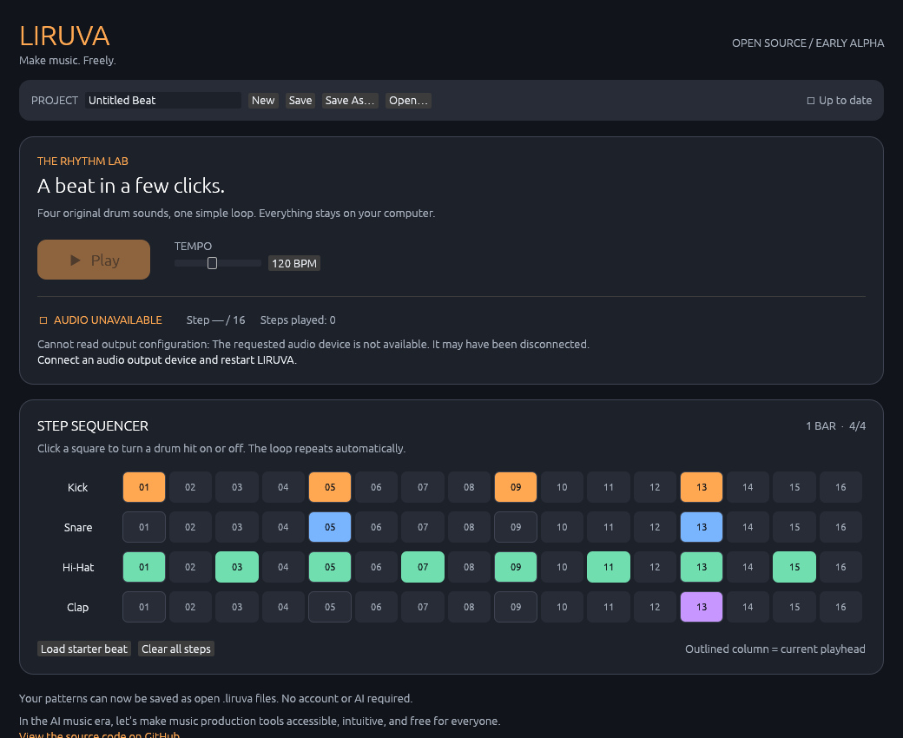

# LIRUVA

**Make music. Freely.**

> In the AI music era, let's make music production tools accessible, intuitive, and free for everyone.

[](LICENSE)
[](https://github.com/edujbarrios/liruva/actions/workflows/ci.yml)

LIRUVA is an independent, community-driven, **free and open-source** digital audio workstation (DAW) at an early stage of development. The goal is to make music production easy to understand without sacrificing creative freedom.

LIRUVA has its own original implementation, dark interface, and identity. It is **not affiliated with Image-Line or FL Studio**.

## A look at LIRUVA



*Real screenshot of the Rust/egui desktop application running under a virtual Linux display. Captured automatically in [GitHub Actions](https://github.com/edujbarrios/liruva/actions/runs/38186742959)—not a concept render or an edited mockup. The virtual display has no physical audio output device, so the screenshot correctly shows “Audio unavailable.” Real speaker playback and native file dialogs still require desktop smoke testing.*

## Development status — Milestone 2.2 (development branch)

The following features are implemented **in this development branch**:

- Rust desktop app with an original, dark, Material-inspired design.
- Four-track drum machine with 16 interactive steps.
- Four original synthesized sounds: Kick, Snare, Hi-Hat, and Clap.
- Looping 4/4 playback with adjustable BPM, Play and Stop.
- **Open**, **Save**, and **Save As** actions using native dialogs.
- Versioned, human-readable `.liruva` project files storing a name, BPM, and all four patterns.
- Validation of malformed or unsupported projects before loading them.
- **New Project** action and confirmation before discarding unsaved changes when opening, creating a new project, or closing the app.
- GPL-3.0-or-later original source, English-only product copy, and automated Rust checks.

**Not implemented:** piano roll, arrangement, MIDI editing, sample imports, plugins, WAV export, mixer, cloud services, or AI integration.

This is a small drum-machine prototype, **not a full DAW yet**. The sound, native dialogs, and accessibility need real desktop testing on Windows, macOS, and Linux before any official release.

## Make your first beat

1. Open LIRUVA and select steps for Kick, Snare, Hi-Hat or Clap.
2. Click **Play**. The bar repeats automatically.
3. Adjust **Tempo** to change the groove.
4. Give the project a name and click **Save**.
5. Quit LIRUVA, start it again, then click **Open** to restore the saved beat.
6. Use **Save As** to create another copy, or **New** to start fresh.
7. If you make changes and try to leave, choose **Save and continue**, **Discard changes**, or **Cancel**.

Files are stored on your own computer as readable JSON with the `.liruva` extension. Read the [project format specification](docs/PROJECT_FORMAT.md) for details. No account, internet access, API key, or AI service is required.

## Build and run

Install a current stable [Rust toolchain](https://rustup.rs/) (minimum supported Rust 1.95) and native desktop development dependencies.

On Ubuntu/Debian:

```bash
sudo apt-get update
sudo apt-get install -y build-essential pkg-config libgtk-3-dev libxkbcommon-dev libwayland-dev libxcb-render0-dev libxcb-shape0-dev libxcb-xfixes0-dev libssl-dev libasound2-dev
```

On Linux, native file dialogs use XDG Desktop Portal (or a supported fallback). A desktop portal service and its backend should be installed; some environments also need Zenity. Windows and macOS need their normal native build tooling.

```bash
git clone https://github.com/edujbarrios/liruva.git
cd liruva
git switch feat/milestone-2-2-safety-and-screenshot
cargo run -p liruva
```

This development branch is part of stacked, unmerged PRs. The sequential branches are `feat/milestone-0-foundation`, `feat/milestone-1-audio-dark-ui`, `feat/milestone-1-2-drum-sequencer`, `feat/milestone-2-1-project-files`, and `feat/milestone-2-2-safety-and-screenshot`.

Verify Rust code locally:

```bash
cargo fmt --all -- --check
cargo clippy --workspace --all-targets -- -D warnings
cargo test --workspace
```

Hardware-free tests run in CI. Physical speaker output and desktop file dialogs cannot be verified in a headless CI environment.

## Core principles

1. **Open source from day one.** Original source is GPL-3.0-or-later; all dependencies and bundled assets must be license-compatible.
2. **Free forever.** No subscriptions, paid features, license keys, or locked functionality.
3. **Simple by design.** Prioritize the shortest path from opening the app to making music.
4. **Local-first.** Projects belong to users, not a cloud provider.
5. **AI is optional.** Users can make music without AI or an internet connection.
6. **Real features only.** Avoid clickable-looking mock controls that do nothing.
7. **English-first.** UI, documentation, error messages, GitHub issues, and PRs are written in English.

## Development and community

See the [roadmap](docs/ROADMAP.md), [architecture](docs/ARCHITECTURE.md), [design system](docs/DESIGN.md), and [contribution guide](CONTRIBUTING.md). Feature proposals and constructive feedback are welcome, especially from beginners.

## License

Copyright (C) 2026 Eduardo J. Barrios and LIRUVA contributors.

All original LIRUVA source is released under [GNU GPL-3.0-or-later](LICENSE). The third-party dependency licensing policy is documented in [docs/DEPENDENCIES.md](docs/DEPENDENCIES.md).

**LIRUVA — Make music. Freely.**
